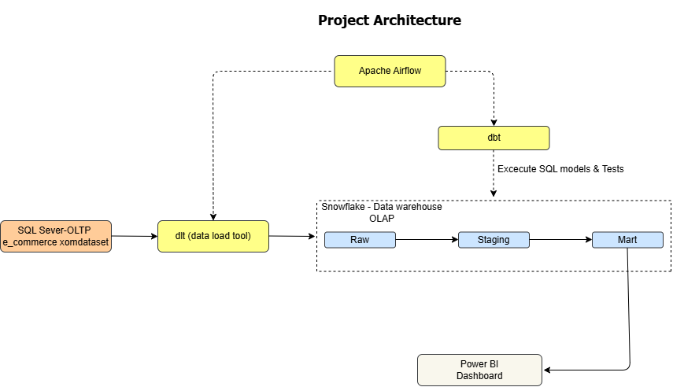

# E-commerce Data Platform

## Mục lục

1. [Modern Data Stack là gì? Gồm những phần gì?](#modern-data-stack)
2. [Kiến trúc dự án](#kien-truc-du-an)
3. [Lựa chọn và so sánh công cụ](#lua-chon-cong-cu)
    - [Data ingestion](#data-ingestion)
    - [Datawarehouse](#datawarehouse)
    - [Transform](#transform)
    - [Orchestration](#orchestration)
    - [Visualization](#visualization)

---

## 1. Yêu cầu đầu tiên a cần e tìm hiểu về modern data stack. Nó là gì? Gồm những phần gì?

- Modern Data Stack (MDS) là tập hợp các công cụ và công nghệ dữ liệu, thường dựa trên nền tảng đám mây, được tích hợp để thu thập, lưu trữ, chuyển đổi, phân tích và quản trị dữ liệu. MDS có tính mô-đun và hỗ trợ tự động hóa quy trình dữ liệu, giúp tổ chức duy trì chất lượng dữ liệu và sử dụng dữ liệu hiệu quả.

- Hiện nay các cty chủ yếu dùng MDS thay vì LDS bởi chi phí được tối ưu hơn, xử lý được vấn đề cập nhật realtime data, lưu trữ, xử lý các dữ liệu có cấu trúc hoặc không có cấu trúc tiện lợi hơn.

- MDS thường bao gồm: **Data storage, data ingestion, data transformation, BI and Analytics, Data observability**.

    - **Data storage:** Đây là môi trường lưu trữ, quản lý structured, semi-structured và unstructured data, các tổ chức có thể dựa theo các yếu tố như chi phí, tính hiệu quả để có thể chọn 1 data storage phù hợp (data warehouses / data lakes / data lakehouses).

    - **Data ingestion:** Đây là quy trình thu thập và nhập data vào trong môi trường lưu trữ tập trung cho việc xử lý và phân tích (batch processing / real-time processing).

    - **Data transformation:** Biến đổi raw data thành clean data, có cấu trúc và tối ưu hóa cho việc phân tích, report,... (Data cleaning, normalization, aggregation, merging).

    - **BI and analytics:** Đây là phần sử dụng dữ liệu đã được xử lý để phân tích, trực quan hóa và tạo insight thông qua data analytics, visualization, trend analysis, SQL query and AI-driven automation.

    - **Data observability:** Đây là phần đảm bảo chất lượng, tính khả dụng và độ tin cậy của data, giúp tránh việc dây chuyền bị phá vỡ, thiếu dữ liệu hay xử lý chậm.

Ngoài 5 cái chung chính ra còn có **data orchestration, data discovery, data governance, data cataloging, ML and AI**.

---

## 2. Kiến trúc dự án

---

## 3. Lựa chọn và so sánh công cụ

> **dlt → Snowflake → Dbt → Airflow → PowerBI**

| Công đoạn | Công cụ được chọn |
| :--- | :--- |
| Data ingestion | **dlt** |
| Datawarehouse | **Snowflake** |
| Transform | **Dbt** |
| Orchestration | **Airflow** |
| Visualization | **PowerBI** |

### 3.1. Đầu tiên ở bước data ingestion:

#### dlt

sau khi đọc qua tôi thấy dùng dlt sẽ ok hơn là tự viết script ở thời điểm hiện tại. Do là ngta có sẵn 1 repo trên github để hướng dẫn mình sử dụng, có sẵn script để mình dựa vào đó để làm theo.

**Ưu điểm sẽ là**

- nhẹ và tiết kiệm tài nguyên,
- tự động suy luận kiểu dữ liệu và cấu trúc lại bảng,
- tốc độ xử lý nhanh,
- dễ dàng quản lý bằng git,
- miễn phí và ko giới hạn tính năng.

**Nhược điểm sẽ là**

- phải có kiến thức về python,
- các thư viện connector có sẵn khá ít (chỉ có ở các nguồn dữ liệu phổ biến hiện nay)

#### Airbyte

Và tiếp theo là Airbyte, cnay cũng có thể chạy local thông qua docker,

**ưu điểm sẽ là** không cần tạo code để chạy chỉ cần install về máy và điền trực tiếp thông tin của SQL sever và snowflake trên giao diện UI khi kết nối luôn.

**Nhược điểm sẽ là**

- ngốn ram,
- tốc độ đồng bộ có thể sẽ không đc tối ưu như code thuần,
- khó quản lý phiên bản,
- và dùng bản free bị cắt giảm khác nhiều (ko phân quyền, không chia đc không gian làm việc cho mng trong các đội khác nhau --> Sau này ứng dụng trong doanh nghiệp thực tế nếu muốn trải nghiệm đầy đủ sẽ phải dùng bản trả phí).

--> Nó sẽ tiện lợi khi connect từ nhiều nguồn dữ liệu khác nhau, ko hợp với những database lớn.

#### Fivetran

Fivetran: Đây là 1 platform chạy thông qua đám mây nên là sẽ không bị tốn tài nguyên, tính ổn định cao và được tối ưu trong việc nhập dữ liệu (lấy dữ liệu real-time với độ trễ thấp)

những chi phí sử dụng khác cao (tính tiền theo số lượng dòng dữ liệu có sự thay đổi hoặc được thêm mới trong tháng) và dữ liệu sẽ được đi qua bên thứ 3 (chạy qua hạ tầng của Fivetran) nên quá trình kiểm duyệt pháp lý sẽ khắt khe hơn.

#### ADF (Azure Data Factory)

ADF (Azure Data Factory): Đâu cũng là 1 nền tảng đám mây giống Fivetran và có thể cài đặt lịch chạy auto, chỉ khác là nó sẽ có thêm quy trình transform, dùng giao diện kéo thả để tạo bước transform.

Nhưng có một điểm đó chính là chạy đến đâu tính tiền đến đó (phí điều phối, phí di chuyển dữ liệu, phí transform dữ liệu)

---

### 3.2. Datawarehouse

Tiếp theo là về datawarehouse, em đã được thử dùng Snowflake, Google BigQuery và Databricks nhưng mà em thấy Snowflake có giao diện và các setup dễ sử dụng nhất.

---

### 3.3. Transform

#### dbt

Về phần các tool trong đoạn transform, em chọn sử dụng dbt là do đây là tool đầu tiên em được học và cũng đã quen hơn trong việc sử dụng nó.

#### SQLMesh

Ngoài ra còn có SQLMesh là một tool chạy được local cho phép khai báo model bằng SQL thuần túy (loại bỏ sự phụ thuộc vào Jinja và YAML), hỗ trợ sơ đồ phụ thuộc tới cấp độ cột (Column-level Lineage), và có khả năng phân biệt rõ ràng giữa thay đổi phá hủy cấu trúc (breaking) với thay đổi thông thường (non-breaking). Cơ chế này giúp tối ưu chi phí hiệu năng tối đa khi một sửa đổi nhỏ sẽ không kéo theo việc phải tính toán (build) lại toàn bộ các nhánh hạ nguồn."

#### matiliion và Mage.ai

Ngoài ra còn có matiliion ko cần code, kéo thả UI để transform nhưng chi phi khá cao (do tính theo thời gian chạy) và Mage.ai chia pipeline thành các khối chức năng, tích hợp sẵn dbt và pyhon, hỗ trợ tự động sinh code pipeline, test,... cơ chế tự sửa lỗi nhưng nếu xử lý xữ liệu quá lớn sẽ ngốn nhiều ram trên máy tính.

---

### 3.4. Orchestration

#### Airflow và Prefect

Phân orchestration, em chọn dùng airflow do đây cũng là tool đầu tiên em học sử dụng bị 1 cái là chạy khá ngốn ram, em có tìm hiểu thì có cái prefect có một số ưu điểm là:

**Cực kỳ linh hoạt (Dynamic Workflows):** Airflow bắt buộc sơ đồ chạy (DAG) phải cố định trước khi chạy. Prefect cho phép thay đổi luồng chạy ngay trong lúc pipeline đang thực thi (ví dụ: nếu dữ liệu lớn hơn 100 dòng thì chạy tiếp, nhỏ hơn thì dừng),

**truyền dữ liệu mượt mà:** Prefect xử lý việc truyền dữ liệu giữa các Task rất tự nhiên như các hàm Python thông thường,có thể chạy code trên máy local của mình nhưng quản lý giao diện, lịch chạy hoàn toàn trên web đám mây miễn phí của Prefect và cái Mage.ai em đề cập ở trên cũng có thể dùng để điều phối.

---

### 3.5. Visualization

Cuối cùng là visualization,

#### Power BI :

**Ưu điểm:** Phổ biến nhất, chi phí rẻ, tích hợp hoàn hảo với hệ sinh thái Microsoft, kết nối DirectQuery với Snowflake rất mượt.

**Nhược điểm:** Bản Desktop chỉ chạy trên Windows, dễ bị loạn logic nếu xào nấu dữ liệu quá nhiều trên Dashboard thay vì làm sạch trước ở dbt.

#### Tableau:

**Ưu điểm:** Biểu đồ cực kỳ đẹp, kéo thả linh hoạt, mạnh về kể chuyện bằng dữ liệu (Data Storytelling), chạy tốt trên cả Windows và macOS.

**Nhược điểm:** Chi phí bản quyền rất đắt đỏ, khó học các tính năng nâng cao.

#### Google Looker Studio:

**Ưu điểm:** Hoàn toàn miễn phí, chạy 100% trên web, dễ dùng, làm báo cáo nhanh rất tiện.

**Nhược điểm:** Tính toán nâng cao yếu, tải biểu đồ chậm khi kết nối với các nguồn ngoài Google (như Snowflake) với lượng dữ liệu lớn.

